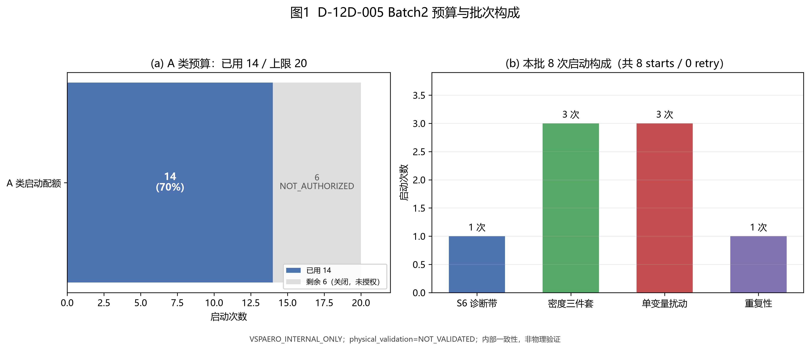
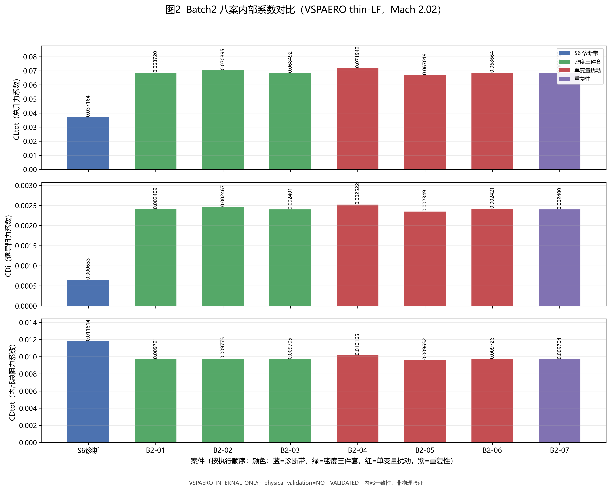
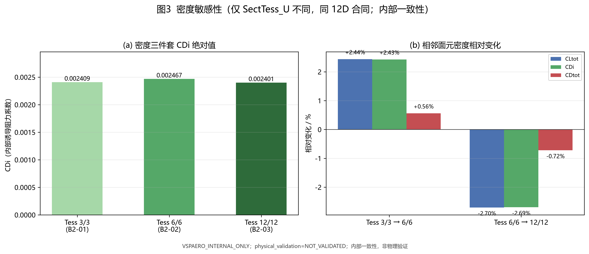
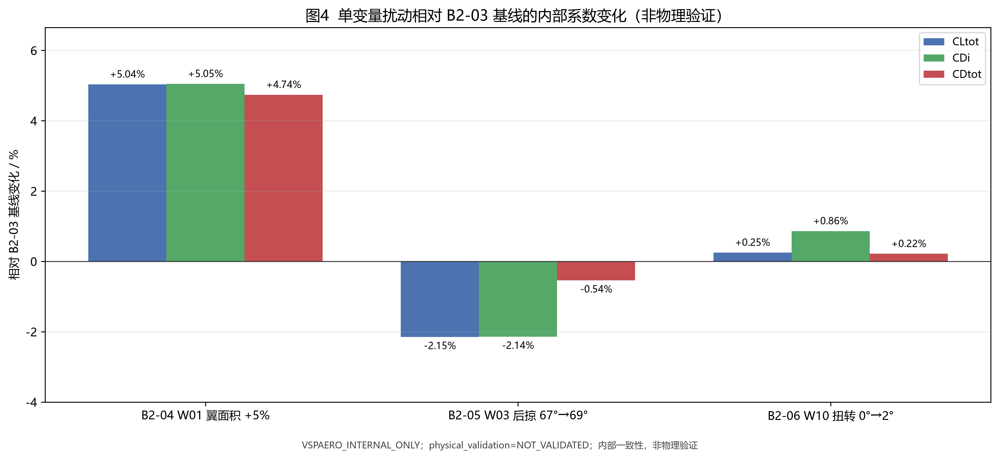
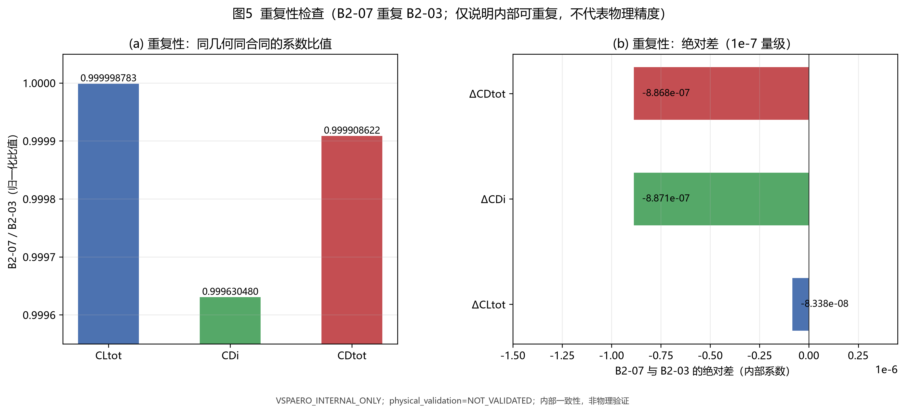

# D-12D-005 Batch2 执行报告（VSPAERO 7.2.2 thin-LF，A 类 8 次启动）

> 状态：**FINAL（Lead 合并稿）**；A5 task-138 结论 APPROVE_BATCH2_RESULTS_AND_CLOSE_A_LINE（0 blocker / 0 major / 4 minor，已按 A5B2R-01..04 修正）；A3 task-139 审计 PASS（critical 40/40）；入库路径 `docs/reviews/d12d005_batch2_report_20261104.md`。
> 生成：2026-11-04T14:13:12Z（A2）；Lead 合并：2026-11-04；证据根（仓库相对）：`research/concorde_metaopt/optimization_runs/d12d005-20261104T0430Z/evidence/batch2`。外部审计状态根在本报告简记为 `EXT`（仓库外，不随仓库发布）。
> 标签：**VSPAERO_INTERNAL_ONLY**；physical_validation=**NOT_VALIDATED**；本报告全部 CD 均为内部求解器系数，不是经物理验证的真实阻力。
> 本报告数值由零求解复算脚本从原始证据重新计算后生成；复算与任务卡数值一致性见 §9。

## §1 目的与授权

本轮为 D-12D-005 A 类第一批之后的 **Batch2**：在 Lead 书面授权下，对 VSPAERO 7.2.2 thin-LF 在 Mach 2.02 的**内部一致性**做小样本诊断，覆盖诊断带 1 案、密度三件套 3 案、单变量扰动 3 案、重复性 1 案，共 8 次启动。

- 授权文件（仓库外）：`EXT/d12d005/lead/D12D005_BATCH2_AUTHORIZATION_20261104T130635Z.json`
- 授权 sha256：`fd02dd898c816ad702a49e408ca4f31ea193a806275b9ffe95aa9d28e8507ecc`；authorization_id：`D12D005-BATCH2-20261104T130635Z`；issued_utc：2026-11-04T13:06:35Z。
- A5 冻结计划（仓库外）：`EXT/d12d005/a5/batch2_prestart_gate/batch2_plan_frozen_candidate.json`
- 前置独立核实：A2 task-130 prestart PASS；A3 task-134 PASS（31/31）；A5 v1b freeze PASS。
- 目标仓库：`D:/RCAIDE-d12d005`，分支 `research/d12d005-aero-fallback`，执行 HEAD `c1168ec656160a3e35e5e157050e98ac1fde8cdf`（执行前后未变更）。
- 范围：恰好 8 starts、串行、`-omp 4`、单案 ≤900 s、RSS ≤16 GB、**0 retries、不允许 case substitution**；B/C/D/E/P4 类 0 启动。
- 预算基线：A 类批前 6/20，本批 8 次后 **14/20**，剩余 6 次**关闭**（NOT_AUTHORIZED，不重分配、不结转）。

## §2 执行事实与预算

执行顺序：`S6_STD_M2p02_aoa1 → B2-01 → B2-02 → B2-03 → B2-04 → B2-05 → B2-06 → B2-07`，逐案串行；每案启动前完成授权/计划 sha、HEAD、exe sha、无其他 vspaero 进程、a0v2 stop_before_run==1、bundle 7 文件、17/17 合同回读、PC-09 vkey/vspgeom 一致性等预启动门（8/8 `prestart_checks.all_pass=true`）。

| 案件 | 事件 | wall / s | rc | 峰值 RSS / GB | 结果分类 |
| --- | --- | --- | --- | --- | --- |
| S6 | NA-D12D005C-001 | 0.762 | 0 | 0.098 | SOLVED_VALID_WITH_DERIVED_WARNINGS |
| B2-01 | NA-D12D005C-002 | 0.259 | 0 | 0.002 | SOLVED_VALID_WITH_DERIVED_WARNINGS |
| B2-02 | NA-D12D005C-003 | 0.521 | 0 | 0.059 | SOLVED_VALID_WITH_DERIVED_WARNINGS |
| B2-03 | NA-D12D005C-004 | 1.759 | 0 | 0.226 | SOLVED_VALID_WITH_DERIVED_WARNINGS |
| B2-04 | NA-D12D005C-005 | 1.511 | 0 | 0.244 | SOLVED_VALID_WITH_DERIVED_WARNINGS |
| B2-05 | NA-D12D005C-006 | 1.511 | 0 | 0.238 | SOLVED_VALID_WITH_DERIVED_WARNINGS |
| B2-06 | NA-D12D005C-007 | 1.761 | 0 | 0.212 | SOLVED_VALID_WITH_DERIVED_WARNINGS |
| B2-07 | NA-D12D005C-008 | 1.762 | 0 | 0.294 | SOLVED_VALID_WITH_DERIVED_WARNINGS |

- 合计 wall = **9.846 s**（最大单案 1.762 s，远低于 900 s/案门限）；峰值 RSS 最大 **0.294 GB**（门限 16 GB）。
- 停止规则：**未触发**（`batch_state.stopped=false`）；0 retries；ledger 16 行（8 PENDING + 8 COMPLETED，append-only），billable events = 8。
- A 类预算（`budget_ledger.json` 复算）：used_before=6，starts_this_batch=8，cap=20，used_total_after=14，remaining_after=6。
- history 由 verify-history 判定 PASS（每案 5 次尾迹迭代，见 batch2_report.md）；polar 单行（S6 AoA=1、12D 案 AoA=2），polar 48 列。
- 取证快照字段说明（A5B2R-02/03）：`batch2_results.json` 的 `cases[*].history_iterations` 与 `run.run_start.last_solver_finish_utc`、ledger `stdout_sha256` 为 null 属快照字段未回填；原始 history 每案 5 行（verify-history PASS），每案 solver stdout 已归档于 `cases/<case>/results/solver_stdout.log`。原始证据不改写；详见 `evidence/batch2_corrections.json`。

## §3 八案结果（内部求解器系数）

| 案件 | 用途 | AoA | CLo | CLi | CLtot | CDo | CDi | CDtot | E | L/D | verify-polar | verify-history |
| --- | --- | --- | --- | --- | --- | --- | --- | --- | --- | --- | --- | --- |
| S6 | 诊断带（标准翼 AoA=1） | 1.0 | -0.000194820 | 0.037359044 | 0.037164223 | 0.011161251 | 0.000652722 | 0.011813973 | 0.168388 | 3.145785 | PASS_WITH_WARNINGS | PASS |
| B2-01 | 密度 3/3 | 2.0 | -0.000255346 | 0.068975470 | 0.068720124 | 0.007312156 | 0.002408677 | 0.009720833 | 0.341027 | 7.069366 | PASS_WITH_WARNINGS | PASS |
| B2-02 | 密度 6/6 | 2.0 | -0.000255200 | 0.070650160 | 0.070394960 | 0.007307980 | 0.002467158 | 0.009775138 | 0.349370 | 7.201429 | PASS_WITH_WARNINGS | PASS |
| B2-03 | 基线 12/12 | 2.0 | -0.000255062 | 0.068747022 | 0.068491960 | 0.007304030 | 0.002400696 | 0.009704726 | 0.339892 | 7.057588 | PASS_WITH_WARNINGS | PASS |
| B2-04 | W01 翼面积 +5% | 2.0 | -0.000266893 | 0.072208523 | 0.071941630 | 0.007642826 | 0.002521957 | 0.010164783 | 0.356962 | 7.077537 | PASS_WITH_WARNINGS | PASS |
| B2-05 | W03 后掠 67→69° | 2.0 | -0.000255027 | 0.067273878 | 0.067018850 | 0.007303029 | 0.002349255 | 0.009652284 | 0.332555 | 6.943315 | PASS_WITH_WARNINGS | PASS |
| B2-06 | W10 扭转 0→2° | 2.0 | -0.000255761 | 0.068919949 | 0.068664188 | 0.007304335 | 0.002421414 | 0.009725748 | 0.338681 | 7.060041 | PASS_WITH_WARNINGS | PASS |
| B2-07 | 重复 B2-03 | 2.0 | -0.000255062 | 0.068746939 | 0.068491877 | 0.007304030 | 0.002399809 | 0.009703839 | 0.340017 | 7.058225 | PASS_WITH_WARNINGS | PASS |

- 8/8 结果分类均为 `SOLVED_VALID_WITH_DERIVED_WARNINGS`；主系数（CLo/CLi/CLtot/CDo/CDi/CDtot/CMytot/CMztot）全部有限，**无停止规则触发**。
- 唯一警告：派生效率列 `Ew=inf`（8/8）。原因（A5 task-138 A5B2R-01 更正）：thin 孤立翼 polar 中 `CDiw=0`（且 `CLiw=0`），派生比值 Ew=CLtot²/(π·AR·CDiw) 的分母为 0 → inf；这是**派生列 0/0 伪影**，不是求解发散（主系数全部有限）。按授权派生列非有限仅记 WARNING，不触发停止。
- 合同：12D 案 Sref=358.25 / Cref=18.489893 / Bref=25.604638 / X_cg=16.821978259514246；S6 案 Sref=4.0 / Cref=1.0 / Bref=4.0 / X_cg=0.25；全部 Mach=2.02、NumWakeNodes=8、WakeIters=5、WakeRelax=1、FarDist=-1、Symmetry=0、Beta=0。

## §4 密度与扰动分析（内部一致性，非物理验证）

### 4.1 密度三件套（同 12D 几何与合同，仅 SectTess_U 不同）

| 对比 | CLtot | CDi | CDtot | ΔCLtot | ΔCDi | ΔCDtot |
| --- | --- | --- | --- | --- | --- | --- |
| Tess 3/3 → 6/6 | 0.068720124 → 0.070394960 | 0.002408677 → 0.002467158 | 0.009720833 → 0.009775138 | +2.4372% | +2.4279% | +0.5586% |
| Tess 6/6 → 12/12 | 0.070394960 → 0.068491960 | 0.002467158 → 0.002400696 | 0.009775138 → 0.009704726 | -2.7033% | -2.6939% | -0.7203% |

观察：CDi 在 3/3→6/6 上升 +2.43%，6/6→12/12 回落 −2.69%，两档相对变化均远小于事先讨论的 15% 量级；但该结果只说明**该薄面 VLM 在 Mach 2.02 的离散敏感性**，不构成网格收敛或物理精度证明（无系统收敛判据，也无实验/高阶 CFD 对照）。

### 4.2 单变量扰动（相对 B2-03 基线）

| 扰动 | ΔCLtot | ΔCDi | ΔCDtot | 相对 CLtot | 相对 CDi | 相对 CDtot |
| --- | --- | --- | --- | --- | --- | --- |
| W01 翼面积 +5%（358.25→376.1625 m²） | +0.003449670 | +0.000121261 | +0.000460057 | +5.0366% | +5.0511% | +4.7405% |
| W03 后掠 1（67°→69°） | -0.001473110 | -0.000051441 | -0.000052442 | -2.1508% | -2.1427% | -0.5404% |
| W10 翼尖扭转（0°→2°） | +0.000172228 | +0.000020718 | +0.000021022 | +0.2515% | +0.8630% | +0.2166% |

观察：W01 面积 +5% 使 CLtot +5.04%、CDi +5.05%（内部近线性）；W03 后掠 +2° 使 CLtot −2.15%、CDi −2.14%；W10 翼尖扭转 +2° 仅使 CLtot +0.25%、CDi +0.86%。这些只证明扰动在求解器内部被稳定分辨（同合同、同面板密度），**不能解释为气动规律或物理效应**。（A5B2R-04：W01 案设计翼面积=376.1625 m²，但合同参考面积固定 Sref=358.25 m² 未随动，故 Δ 含固定 Sref 归一化效应，不能读作纯气动效率敏感性。）

## §5 重复性与确定性

B2-07 与 B2-03 为同几何、同合同、同二进制、同执行路径的重复案（仅随机/时序不同）。

| 指标 | B2-03（基线） | B2-07（重复） | 绝对差 | 相对差 | 比值 B2-07/B2-03 |
| --- | --- | --- | --- | --- | --- |
| CLtot | 0.068491960121 | 0.068491876738 | -8.338e-08 | -1.217e-04% | 0.999998783 |
| CDi | 0.002400696206 | 0.002399809101 | -8.871e-07 | -3.695e-02% | 0.999630480 |
| CDtot | 0.009704726125 | 0.009703839326 | -8.868e-07 | -9.138e-03% | 0.999908622 |

观察：重复案差异在 **1e-7 绝对量级**（复算值），与任务卡一致；说明同一二进制、同输入下 run-to-run 可重复，**不代表物理精度**，也不构成对实验/高阶 CFD 的验证。

## §6 Gate1 / Gate2 / Gate3 现状

| 门 | 状态 | 依据/说明 |
| --- | --- | --- |
| Gate1（授权 / 合同 / 输入门） | **PASS** | 授权 sha256=`fd02dd898c816ad702a49e408ca4f31ea193a806275b9ffe95aa9d28e8507ecc`、A5 计划 sha256=`bc437267705d4df38cd214c1cb3c22d57245aaf5655f13d9f0a1e5e62c9fafd0`、HEAD `c1168ec656160a3e35e5e157050e98ac1fde8cdf` 干净、8/8 预启动门通过（17/17 回读、PC-09、StopBeforeRun=1、无预存 solver 产物）；final_checks 36/36 PASS。 |
| Gate2（诊断 / 可观测性门） | **DIAGNOSTIC_REPAIR_CONFIRMED_BY_S6**（A5 task-138；登记属性仍为 POST_HOC_DIAGNOSTIC） | 事后诊断重注册：S3/S4 诊断带 [0.06,0.09]（观测 0.074251 在带内）；独立确认案 S6 预注册带 [0.03,0.045] PASS；密度三件套、单变量扰动、重复性差异均为内部可观测性记录；**不是事先注册的物理假设检验**，不产生物理通过/不通过结论。 |
| Gate3（物理验证门） | **NOT_REACHABLE / NOT_VALIDATED** | thin-surface VSPAERO 在 Mach 2.02 无已证明的物理有效性；本批只覆盖内部一致性与可重复性，**不得据此签核 LF-M2.02**，不得注入 body correction，不得将 CDtot 作为真实阻力。 |

## §7 B/C 线状态（本轮未触碰）

- A 类：本批后 14/20；剩余 **6 次关闭（NOT_AUTHORIZED）**，不重分配、不结转；任何新启动需新的 Lead 书面授权。
- B 类（RCAIDE VLM 经验低保真回退，evaluator `RCAIDE_VLM_EMPIRICAL_LF_M202`）：cap 12，**0 starts，LOCKED / NOT_AUTHORIZED**；仅在 A 线 FALLBACK_TRIGGERED、evaluator 实现并获新授权后才可启动（本轮未触发）。
- C 类（SU2 Euler 交叉检查）：cap 4，**0 starts，LOCKED / NOT_AUTHORIZED**。
- 其他（OpenVSP WaveDrag、批量真实 DOE/BO/DE、真实航空 MAML、P5/P6）：均 0 starts，未授权。

## §8 限制与下一步

限制：
1. thin-surface VSPAERO 为内部求解器；Mach 2.02 物理有效性未验证，CDtot 不是真实阻力，不得用于验收或签核。
2. polar 仅单 AoA 点（S6 AoA=1、12D 案 AoA=2），无升阻极曲线斜率/配平信息。
3. 12D 案只含主翼（lifting-surfaces-only），不含机身、垂尾、翼身干扰；S6 为标准矩形翼。
4. 派生列 Ew=inf 说明该效率量不可用；E、L/D 亦为内部量。
5. 密度三件套只有三档离散面元，不构成网格收敛研究；单变量扰动只做定性分辨，不做物理敏感性结论。
6. 峰值 RSS 为 0.25 s 轮询采样，可能低估瞬时峰值（实测最大 0.294 GB，远低于 16 GB 上限）。

下一步：
1. A5 结果复核：task-138 = APPROVE_BATCH2_RESULTS_AND_CLOSE_A_LINE（0 blocker / 0 major / 4 minor，已按 A5B2R-01..04 修正）。
2. A3 隔离审计：task-139 = PASS（critical 40/40；证据 241 文件 / 7,788,381 B；审计时未提交、未推送）。
3. 入库：Lead 已将 `evidence/batch2/`、5 张中文图、本报告与 10 个交付 JSON 一并提交并推送（提交 sha 见 Issue #4 事实回执）。
4. 若后续需要 LF-M2.02 的物理结论，必须走不同的物理验证方法（如 SU2 Euler / 实验）并申请新授权；不得复用本批内部系数作为物理证据。

## §9 证据清单与复算

### 9.1 复算一致性（零求解、只读原始证据）

复算脚本：`recompute_batch2.py`；输出：`recompute.json` / `recompute.md`。方法：直接解析每案 bundle 内 VSPAERO 7.2.2 48 列 polar 的 AoA 单点行，预算/重试从 `ledger.jsonl` 与 `budget_ledger.json` 复算，delta/百分比由复算值计算。

- 与任务卡数值比较：**60/60 项一致，0 项不一致**（6 位小数容差 1e-6；百分比容差 0.01 pp；重复性 delta 容差 1e-9；预算计数精确相等）。
- 与 `analysis.json` 的 primary_values 交叉核对：8 案 × 3 系数全部在 1e-12 内一致。

### 9.2 关键证据文件（sha256）

| 文件 | 字节 | sha256 |
| --- | --- | --- |
| `evidence/batch2/batch2_results.json` | 47367 | `0ffb4906d65ee6d52f047b39add3d94ccf2d3c187a84382d47a6f7927e3c9a06` |
| `evidence/batch2/batch2_report.md` | 9810 | `76ac086ce68dce24bf9a2e8018cd5e17f002bf0ecd5e549a13977129e3816efb` |
| `evidence/batch2/final_checks.json` | 6285 | `c9657c8276c76093179bda612e4f40f5976873b569905578a00facc3303ce35c` |
| `evidence/batch2/ledger.jsonl` | 54057 | `a895c4f65df5aef0f5f47dabc9a05506ceed477bf5ffe80a0d47f4bf56376897` |
| `evidence/batch2/batch_state.json` | 8013 | `e90f3e835a2ad94eaed624ba2c51a072a7006926f5c8e37e416c373f117cbbcb` |
| `evidence/batch2/budget_ledger.json` | 928 | `e138b1215e994f18c2453de85a99355ffcdada7a8441ce94574e39fca3f4b09f` |
| `evidence/batch2/run_start.json` | 12607 | `26d06acf8b741a74fb27e805c0c2fc9c75d0d2190336f89dd92dc1be4f37455b` |
| `authorization (EXT)` | 7547 | `fd02dd898c816ad702a49e408ca4f31ea193a806275b9ffe95aa9d28e8507ecc` |
| `A5 frozen plan (EXT)` | 20206 | `bc437267705d4df38cd214c1cb3c22d57245aaf5655f13d9f0a1e5e62c9fafd0` |

### 9.3 图与复算产物（EXT/d12d005/a2/batch2_figures/）

| 文件 | 字节 | sha256 | 布局自检 |
| --- | --- | --- | --- |
| `figures/fig1_budget_and_scope.png` | 209695 | `1395c8580e6ad6eb5d046ea8b2d97b416590160727dd1922833d398cc2bb73e7` | PASS |
| `figures/fig2_case_coefficients.png` | 372259 | `3fbbe3c65192e718ec463988e67a27ebb5aa953eb21583c344b28bdcc8e319bc` | PASS |
| `figures/fig3_density_sensitivity.png` | 208607 | `7195ef04bb9242f40d7e146487f5e1648371923425d6ce4ba20dca602b70a24f` | PASS |
| `figures/fig4_perturbation_delta.png` | 169150 | `0dcddaa9bc56b76b6631e64a21a55f98370f92c1cb9bcb2f7e0021d1ffeabfc5` | PASS |
| `figures/fig5_repeatability.png` | 215350 | `86de90be062765fa08456c60761a768469b9c60c2ce409bde335e4f7a6616a2d` | PASS |
| `recompute.json` | 17906 | `e838104d471cf01a392fac5d36a00760d486e52add81e77ef76a1285d559122e` | - |
| `recompute.md` | 1565 | `8a72a404b84f6b81457b9687c7f00bfd051f851e9df5e1b56338eb66cbbab3dc` | - |
| `figures_manifest.json` | 2454 | `13652a739c9d29806e56e0e7410d2b594f83aafb3d465974c19c9d0c10f8186b` | - |
| `gen_figures.py` | 13225 | `670c7b9dcaa77e783aa480a5ca189f0df1bf35d35c1f32bee91ee360b2e2cda3` | - |
| `recompute_batch2.py` | 11141 | `aee1b0e5fb5e6654bc2518110b4695f53c1d188e48297238bd6813007cd9b9d4` | - |

### 9.4 图表与复算产物位置（入库后）

- 5 张中文图（300 dpi、Microsoft YaHei）：`docs/reviews/figures/d12d005_batch2/`（fig1..fig5，文件名不变）。
- 图与复算产物清单、字节与 sha256 见 §9.3 及 `figures_manifest.json` / `SHA256SUMS.txt`。
- 复算与出图溯源副本（草稿报告、脚本、JSON、manifest）：`research/concorde_metaopt/optimization_runs/d12d005-20261104T0430Z/evidence/a2_batch2_figures/`。
- 入库后 `data_manifest.json` 对 run 目录全部文件（含 5 张图、本报告）记录 raw + canonical-LF 双哈希。

---

_本报告为 D-12D-005 Batch2 最终报告（Lead 合并稿）；全部数值可由 §9 证据文件与复算脚本复现；内部系数不得作为物理证据或验收依据。_

## §10 复核与入库记录

| 角色 | 任务 | 结论 |
| --- | --- | --- |
| A5 | task-120（A0 rev6/6a @0e62db3） | APPROVE_FOR_BATCH1B（0 blocker / 0 major / 3 minor） |
| A5 | task-125（BATCH1B 复核 + Gate 判定） | CHANGES_REQUESTED（0 / 3 / 6）→ 后续由 A0v2 与 Batch2 处置 |
| A5 | task-131（Batch2 零求解预启动 gate） | APPROVE_BATCH2_8（0 / 0 / 4 minor；erratum 澄清 S4/S5 已在 batch1b 执行） |
| A5 | task-138（Batch2 结果复核） | APPROVE_BATCH2_RESULTS_AND_CLOSE_A_LINE（0 / 0 / 4 minor） |
| A3 | task-121（A0 rev6/6a 隔离） | PASS（critical 72/72） |
| A3 | task-134（Batch2 预启动隔离） | PASS（critical 31/31） |
| A3 | task-139（Batch2 证据完整性） | PASS（critical 40/40，warning 2/10） |
| Lead | Batch2 书面授权 | authorization_id D12D005-BATCH2-20261104T130635Z；sha256 `fd02dd898c816ad702a49e408ca4f31ea193a806275b9ffe95aa9d28e8507ecc` |

入库交付物（写在 run 目录 `research/concorde_metaopt/optimization_runs/d12d005-20261104T0430Z/`）：`run_config.json`、`approval_and_budget_ledger.json`、`evaluations.jsonl`、`solver_case_matrix.csv`、`vspaero_diagnostics.json`、`rcaide_fallback_results.json`、`su2_crosscheck.json`、`drag_component_ledger.json`、`summary.json`、`data_manifest.json`；证据 `evidence/batch2/`（241 文件 / 7,788,381 B）、`evidence/batch2_corrections.json`、`evidence/a2_batch2_figures/`。

> 物理口径：本轮 14 次 A 类启动全部为 VSPAERO thin-LF 内部计算；`CDtot` 不是真实阻力，机身修正、面积律与 LF-M2.02 均未签核；六门禁状态不变（GEO-12D PARTIAL / LF-M2.02 NOT_VALIDATED / HF-M2.02 PARTIAL / BODY-CORR BLOCKED / MISSION-DATA PARTIAL / BUDGET 门控中）。
